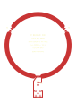
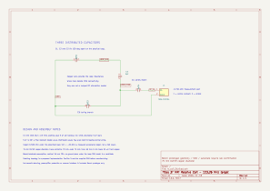

# 3T receive-coil KiCad project

Editable KiCad schematics, PCBs, project settings and local libraries for the MR Systems Engineering construction task.

**Engineering prototype.** The source does not specify the diameter convention, exact SMA part, substrate or complete matching schematic. These are explicit design decisions below. No final capacitance, measured resonance, S11 performance or MRI safety approval is claimed.

## Open or download

Download the [complete checked package](dist/3T_Receive_Coil_KiCad.zip) after the [validation report](validation/STATUS.md) says **PASS**. The ZIP is created only if native KiCad checks and geometry/netlist assertions succeed.

Open either project's **rx_coil_3t.kicad_pro** in KiCad 9 or 10. Both folders contain their own symbols and footprints.

| Project | Meaning of the handout's 75 mm | Centreline diameter | Outer copper diameter | Inner copper diameter |
|---|---|---:|---:|---:|
| [outer_75mm](projects/outer_75mm) | Outer copper diameter | 70 mm | 75 mm | 65 mm |
| [centerline_75mm](projects/centerline_75mm) | Conductor centreline diameter | 75 mm | 80 mm | 70 mm |

**Select one interpretation with the supervisor before manufacturing.** Neither is asserted to be uniquely specified by the handout.

## Included

- Linked schematic, routed PCB, project file and local symbol/footprint libraries.
- Three exact circular, 5 mm wide conductor arcs; C1, C2 and C3 positioned 120 degrees apart.
- 35 micrometre front copper specified in the stackup.
- 1210 / 3225 metric lands; C4 is a separate, additional series-matching capacitor.
- SMA feed using a **candidate Amphenol RF 132134 vertical through-hole footprint**.
- BOM, placement information, dimensional manifest and native schematic/PCB previews.
- Native ERC, DRC with schematic parity, explicit netlist comparison and geometry checks.
- Gerber X2, plain RS-274X compatibility exports and metric Excellon drill data.
- STEP review model of the PCB and capacitors, with official capacitor models. The SMA has a verified land pattern but no included 3D body model.
- Reproducible generation/validation scripts; SHA-256 manifest in the checked ZIP.

## Limits

All capacitors show initial 5 pF values. The source calls for starting with 5 pF; C4's initial value is a design assumption. These values are **not a claim of resonance at 123.26 MHz**. Distributed C1/C2 values may also need changing during bench tuning; do not assume C3/C4 alone provide sufficient adjustment.

Copper arcs provide distributed inductance. The schematic documents connectivity, not a lumped RF simulation.

There is **no transmit detuning, preamplifier protection or approved scanner interface**. This is a supervised bench-development design. The exact connector's material and MR suitability must be checked separately.

Read [DESIGN_NOTES.md](DESIGN_NOTES.md) before fabrication. Manufacturing exports are marked **review**, not fabrication release.

## Online build

The [Actions workflow](.github/workflows/coil.yml) uses the official KiCad 9.0.7 image pinned by digest. It saves generated files only on **kicad-3t-receive-coil**. The portfolio's default branch and published site are not modified.

This branch is public because it is hosted in an existing public repository. No source handout file, personal documents or credentials are included.

### Native previews: 75 mm outer interpretation

Native validation results and previews are included in the download. See the validation report for the exact source commit and KiCad version.
